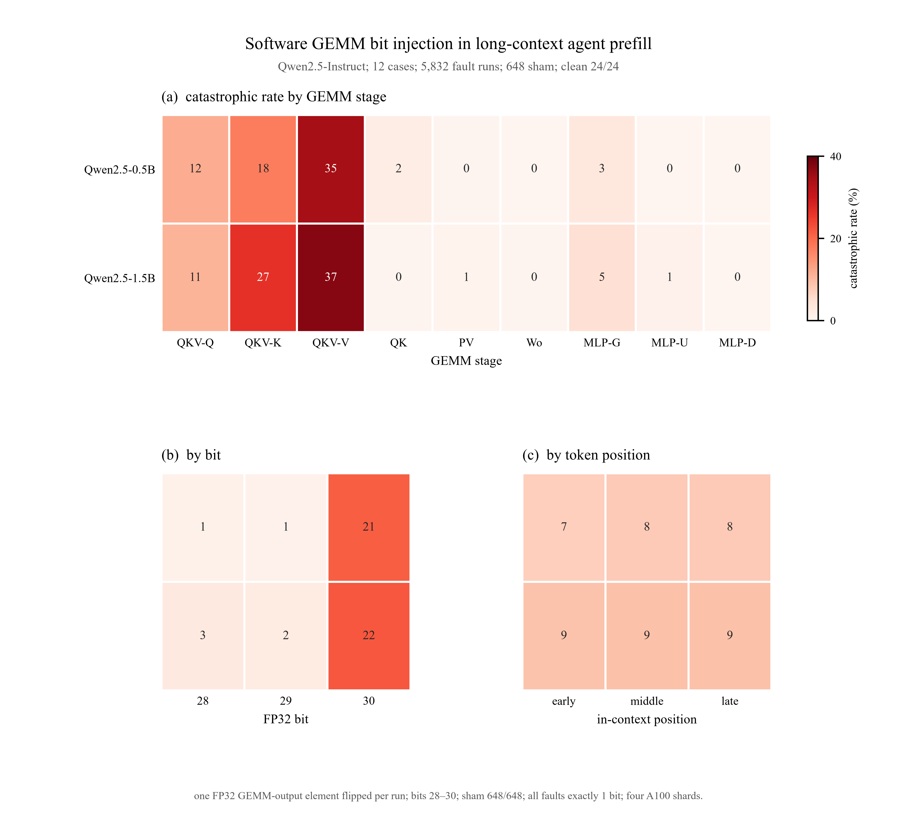

# Long-context agent prefill：软件 GEMM 注错实验报告

日期：2026-10-21  
模型：Qwen2.5-0.5B-Instruct / Qwen2.5-1.5B-Instruct（FP32）  
场景：12 个长上下文 agent case，长 system/专有内容 + user 问题 → prefill → 短答案  
注入：软件 GEMM 输出单 bit flip，bits 28–30，9 个 GEMM stage，3 个 token position  
状态：**完整软件矩阵已完成**，四卡 wall time 约 10 分钟

## 摘要

- 12 个 case 在两个模型上都达到 **clean 100%（24/24）**。
- 共 **5,832 个 fault run**：2 模型 × 12 case × 3 层 × 9 stage × 3 bit × 3 position。
- 648 个 sham 全部与 clean 一致；5,832 个 fault 全部恰好改变 1 bit。
- 总体 catastrophic：**489/5,832 = 8.38%**；literal garble 只有 **11/5,832 = 0.19%**。
- 失败高度集中在 **QKV projection**：
  - `qkv_v`：Qwen0.5B 34.9%，Qwen1.5B 37.3%
  - `qkv_k`：17.6% / 26.5%
  - `qkv_q`：11.7% / 10.8%
- `QK`、`PV`、`Wo`、MLP 的单元素注错大多被 masked（多数 <5%）。
- **bit 30 是主导因素**：Qwen0.5B 21.2%，Qwen1.5B 22.0%；bit 28/29 约 1–3%。
- token position 影响很小：early/middle/late 均约 7–9%。
- 248/5,832 个注入值变成 nonfinite（主要是 bit30），说明高位 exponent 注错不仅会产生错误答案，也可能直接产生 NaN/Inf 型数值。

矢量版：[`figures/agent_software_gemm_summary.pdf`](figures/agent_software_gemm_summary.pdf)

图注：**(a)** 两个 Qwen 模型在 9 个 GEMM stage 上的 catastrophic rate；**(b)** bit 28/29/30；**(c)** 长上下文内的 early/middle/late token 位置。完整矩阵 5,832 个 fault，648 个 sham，24 个 clean；所有 fault 恰好改变 1 bit。

---

## 1. 实验输入

### 1.1 模型

| 模型 | 层数 | hidden | Q / KV heads | E/M/L |
|---|---:|---:|---|---|
| Qwen2.5-0.5B-Instruct | 24 | 896 | 14 / 2 | 0 / 12 / 23 |
| Qwen2.5-1.5B-Instruct | 28 | 1536 | 12 / 2 | 0 / 14 / 27 |

均为 **FP32**，`attn_implementation="eager"`；每模型约 6.3 GiB（1.5B）和 2.2 GiB（0.5B）。

### 1.2 Agent case

12 个合成 agent case，4 类 × 3：

| 类别 | 数量 | 任务 |
|---|---:|---|
| policy QA | 4 | 内部退款政策中查 Tier 1/2/3 金额、review window |
| tool routing | 4 | 内部工具目录中选工具 |
| API lookup | 4 | 内部 API 文档中查 endpoint |

- system context：约 **994–1,281 tokens**；
- 含唯一答案、干扰段落、相似术语；
- user query 要求短答案；
- clean 输出必须严格匹配目标答案。

### 1.3 Clean 校准

| 模型 | clean |
|---|---:|
| Qwen2.5-0.5B-Instruct | 12/12 |
| Qwen2.5-1.5B-Instruct | 12/12 |
| **合计** | **24/24** |

clean 判定允许：
- 数字：精确值；
- tool：工具名出现在开头，允许括号参数；
- API：path 出现在输出中，允许 HTTP method 前缀。

### 1.4 注入设计

| 项目 | 设置 |
|---|---|
| 注入对象 | FP32 GEMM 输出/accumulator |
| stages | qkv_q, qkv_k, qkv_v, qk, pv, wo, mlp_gate, mlp_up, mlp_down |
| bit | 28, 29, 30 |
| 次数 | 每 run 1 bit |
| 元素 | 每个 run 随机一个元素；固定 seed |
| token 位置 | early / middle / late（约 10% / 50% / 90% prompt） |
| 层 | E / M / L |
| decode | 正常 greedy，不再注错 |

实现：

- QKV/Wo/MLP：forward hook 修改对应 linear GEMM 输出；
- QK/PV：patch Qwen eager attention，在 attention score GEMM 和 P·V GEMM 输出上注入；
- 每个 fault 验证 `old/new` int32 和 `bit_diff=1`。

### 1.5 运行矩阵

| 条件 | 数量 |
|---|---:|
| fault | 2 × 12 × 3 层 × 9 stage × 3 bit × 3 position = **5,832** |
| sham | 2 × 12 × 3 层 × 9 stage = **648** |
| clean | 2 × 12 = **24** |
| 合计 | **6,504 runs** |

四卡并行：
- GPU0/1：Qwen1.5B 的 shard 0/1；
- GPU2/3：Qwen0.5B 的 shard 0/1；
- 每个 shard 1,626 行；
- wall time 约 **9–10 分钟**（最长 shard 563.6 s）。

## 2. 总体结果

| 模型 | fault runs | catastrophic | literal garble | wrong | partial | preserved | mean char sim |
|---|---:|---:|---:|---:|---:|---:|---:|
| Qwen2.5-0.5B | 2,916 | **7.72%** | 0.03% | 7.72% | 0.38% | 91.91% | 0.922 |
| Qwen2.5-1.5B | 2,916 | **9.05%** | 0.34% | 9.05% | 0.10% | 90.84% | 0.911 |
| **合计** | **5,832** | **8.38%** | **0.19%** | **8.38%** | **0.24%** | **91.38%** | — |

主要失败仍然是**答案错误**，不是 literal garble。

## 3. 按 GEMM stage

| stage | Qwen0.5B | Qwen1.5B |
|---|---:|---:|
| qkv_q | 11.7% | 10.8% |
| qkv_k | 17.6% | 26.5% |
| **qkv_v** | **34.9%** | **37.3%** |
| qk | 1.9% | 0.3% |
| pv | 0.3% | 0.6% |
| wo | 0.0% | 0.3% |
| mlp_gate | 3.1% | 4.6% |
| mlp_up | 0.0% | 0.9% |
| mlp_down | 0.0% | 0.0% |

**QKV projection 主导失败**，其中 V 最高、K 次之、Q 再次。  
QK/PV/Wo/MLP 的单元素注错大多数被 attention softmax、residual 或后续层吸收。

## 4. 按 bit

| bit | Qwen0.5B | Qwen1.5B |
|---|---:|---:|
| 28 | 1.0% | 2.7% |
| 29 | 0.9% | 2.5% |
| **30** | **21.2%** | **22.0%** |

bit 30 是主要风险源。它改变 FP32 exponent 的高位，容易产生极大的值或 nonfinite；bit 28/29 对最终答案的影响小得多。

## 5. 按 token position

| position | Qwen0.5B | Qwen1.5B |
|---|---:|---:|
| early | 7.3% | 8.8% |
| middle | 7.9% | 9.2% |
| late | 7.9% | 9.2% |

在长上下文中，QKV GEMM 的一个元素错误一旦到达 answer，位置影响并不明显；early/middle/late 近似平坦。

## 6. 按层

| 模型 | E | M | L |
|---|---:|---:|---:|
| Qwen0.5B | 7.8% | 9.4% | 6.0% |
| Qwen1.5B | 11.4% | 9.8% | 6.0% |

late 层略低；early/middle 更高，但差异远小于 stage 和 bit 的差异。

## 7. 按类别

| 模型 | policy QA | tool routing | API lookup |
|---|---:|---:|---:|
| Qwen0.5B | 8.85% | 7.00% | 7.30% |
| Qwen1.5B | 8.64% | 9.57% | 8.95% |

三类任务的失败率接近，说明不是某一类 prompt 的格式问题。

## 8. 关键 stage × bit

| 组合 | Qwen0.5B | Qwen1.5B |
|---|---:|---:|
| qkv_v, bit 30 | **93.5%** | **88.0%** |
| qkv_k, bit 30 | 46.3% | 57.4% |
| qkv_q, bit 30 | 35.2% | 32.4% |
| mlp_gate, bit 30 | 9.3% | 13.9% |
| qk, bit 30 | 5.6% | 0.9% |
| pv, bit 30 | 0.9% | 1.9% |
| qkv_v, bit 28/29 | 6.5% / 4.6% | — |
| wo, any bit | 0.0% | ≤0.9% |

## 9. 典型输出

### 9.1 乱码

**Qwen0.5B，policy_001，qkv_v，L0，bit 30，early**

- clean：`120`
- fault：`!!!!!!!!!!!!!!!!!!!!!!!!`

**Qwen1.5B，api_001，qkv_k，L0，bit 28，middle**

- clean：`/v2/orders/{id}/status`
- fault：`under under under under ...`

### 9.2 流畅但错误

**Qwen0.5B，policy_001，qkv_k，L0，bit 28，early**

- clean：`120`
- fault：`20`

字符层面只少了一个 `1`，但答案完全错误；说明 answer-level 检查不可省略。

**Qwen1.5B，policy_001，qkv_k，L0，bit 28，late**

- clean：`120`
- fault：`NS-OPS-101and NS-REV-501. These codes are internal routing identifiers...`

模型把干扰段落中的内部 code 当成了答案。

## 10. 控制与有效性

| 检查 | 结果 |
|---|---|
| clean 目标答案 | 24/24 |
| sham vs clean | 648/648 全部正确 |
| fault bit 改变数 | 5,832/5,832 恰好 1 bit |
| fault old value present | 5,832/5,832 |
| fault value nonfinite | **248/5,832**，主要来自 bit30 |
| empty output | 3/5,832 |
| runtime error / crash | 0 |

248 个 nonfinite 说明：**bit30 不只是“语义错误”，还可能直接把 GEMM 输出变成 NaN/Inf**；这些 run 仍然完成了 decode，但输出通常是乱码或完全错误。

## 11. 与 NVBitFI Phase 0 的关系

Phase 0 的 NVBitFI 结果：

- layer14 `qkv_v` bit30 在 2,264-token case 上把 `120` 变成 `!!!!!!!!!!!!!!!!`；
- qkv_q/qk/pv/wo/mlp_down 的单点注入被 masked。

软件全矩阵的结果方向一致：

- QKV（尤其 V/K）最容易失败；
- QK/PV/MLP 的单元素失败率低；
- bit30 是最危险的高位。

但两者不能直接比较数值：

- Phase 0 是 BF16 模型 + NVBitFI 的 HMMA FP32 accumulator；
- 本实验是 FP32 模型 + 软件 GEMM 输出；
- 软件矩阵用于覆盖 stage/bit/layer，NVBitFI 用于硬件故障验证。

## 12. 结论

1. 长上下文 agent prefill 中，**QKV projection GEMM 是主要 SDC 入口**，特别是 `qkv_v`。
2. **bit 30** 是主要风险位；bit 28/29 在单元素注入下影响小得多。
3. `QK`、`PV`、`Wo`、MLP 的单元素注错大多被吸收；这不代表多元素/权重故障不会造成错误，但说明单点敏感性集中在 QKV。
4. token position 在这组实验里影响很小；early/middle/late 近似平坦。
5. 248 个 bit30 run 产生 nonfinite GEMM 值，说明输出级检测必须同时覆盖乱码、答案缺失和数值异常。
6. 四卡软件全矩阵约 10 分钟，适合做完整统计；NVBitFI 只适合验证代表 cell。

## 13. 局限

- 软件注入是 FP32 GEMM 输出，不是 NVBitFI 的 BF16 HMMA 硬件故障；不能把 8.38% 当成硬件 SDC 率。
- 每个 cell 只有 3 个 token position、1 个随机元素；没有做多元素/多 bit。
- 12 个合成 agent case，上下文约 1k token；不是完整 agent benchmark。
- clean 100% 使用目标答案匹配；tool/API 允许参数/HTTP method 前缀。
- 没有人工 judge；literal garble 规则较窄。

## 14. 产物

| 产物 | 路径 |
|---|---|
| 数据生成脚本 | `scripts/make_agent_software_cases.py` |
| 软件注入脚本 | `scripts/llm_agent_software_inject.py` |
| 清洁校准脚本 | `scripts/llm_agent_clean_cases.py` |
| 分析/画图脚本 | `scripts/llm_agent_software_analyze.py` |
| 12-case 数据 | `data/agent_software_cases.json` |
| 全部 run | `results/agent_software/runs_all.csv` |
| 汇总表 | `results/agent_software/summary_by_*.csv` |
| 分析元数据 | `results/agent_software/analysis_meta.json` |
| 图 | `results/agent_software/figures/agent_software_gemm_summary.*` |
| 文档图副本 | `docs/figures/agent_software_gemm_summary.*` |
| 四卡日志 | `results/agent_software/logs/` |
