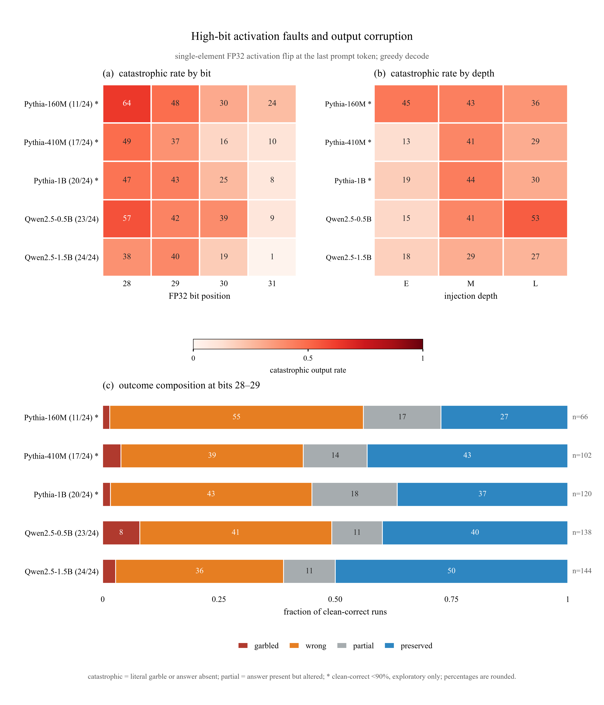

# 高位激活注错与 LLM 输出乱码/错误：实验报告

日期：2026-10-21  
实验：单元素 FP32 activation high-bit fault injection  
模型：Pythia-160M / 410M / 1B，Qwen2.5-0.5B / 1.5B  
范围：prompt prefill 后注错，greedy decode 观察输出  
状态：5 个模型全部完成，1,944 个生成结果，无 OOM

## 摘要

本实验回答两个问题：

1. 输入一组固定 prompt 后，在模型 activation 上翻转一个高位 bit，是否会产生**字面乱码**？
2. 是否会产生**文本仍然流畅、但答案完全错误**的输出？这种错误能否量化？

结论如下：

- **乱码存在，但不是主要失败模式。** 1,440 个 fault run 中，literal garble 为 30 个（2.1%）。Qwen2.5-0.5B 最高（12/288 = 4.2%），表现为语言漂移、越南语重复、退化重复；Qwen2.5-1.5B 出现中文题干片段和全角标点。
- **“答案完全错误”更常见。** 在 1,140 个 clean-correct run 中，358 个 catastrophic（31.4%，95% CI 28.8–34.2%）。per-model catastrophic rate 为 24.7%–41.7%。
- **高位 bit 不是越高越坏。** bit 28/29 在 middle/late 层最容易让答案消失；bit 30 在 early 层很强；bit 30/31 在 late 层通常几乎无影响。唯一明显例外是 Pythia-160M 的 early bit 31。
- **没有 NaN/Inf。** 1,440 个 fault run 的 logits 全部 finite，所有注入值 finite，没有 runtime error。只监控 NaN/Inf 会漏掉这些语义错误。
- **PPL 也不够。** median PPL ratio 约 1.0；clean continuation 在 fault model 下仍可能高概率，但 greedy 输出已经答错。需要输出级 answer/consistency 检查。

矢量版：[`figures/highbit_output_summary.pdf`](figures/highbit_output_summary.pdf)

图注：**(a)** 各模型在 bit 28–31 上的 catastrophic rate，按 E/M/L 三层聚合；**(b)** 各模型在 E/M/L 注入深度上的 catastrophic rate，按 bit 28–31 聚合；**(c)** bit 28–29 合并后的结局构成（garbled / wrong / partial / preserved）。行标签括号内为 clean-correct prompt 数；**(c)** 右侧 `n` 为对应有效 run 数。所有比率都基于 clean-correct prompt；garbled 在 **(c)** 中优先归类，因此与 wrong 不重复计数。

---

## 1. 实验输入

### 1.1 模型输入

| 模型 | Hugging Face ID | 参数量 | 层数 | hidden | Q / KV heads | E/M/L 层 | attention | residual |
|---|---|---:|---:|---:|---|---|---|---|
| Pythia-160M | `EleutherAI/pythia-160m` | 162M | 12 | 768 | 12 / 12 | 0 / 6 / 11 | MHA | parallel |
| Pythia-410M | `EleutherAI/pythia-410m` | 405M | 24 | 1024 | 16 / 16 | 0 / 12 / 23 | MHA | parallel |
| Pythia-1B | `EleutherAI/pythia-1b` | 1.0B | 16 | 2048 | 8 / 8 | 0 / 8 / 15 | MHA | parallel |
| Qwen2.5-0.5B | `Qwen/Qwen2.5-0.5B` | 0.49B | 24 | 896 | 14 / 2 | 0 / 12 / 23 | GQA | sequential |
| Qwen2.5-1.5B | `Qwen/Qwen2.5-1.5B` | 1.54B | 28 | 1536 | 12 / 2 | 0 / 14 / 27 | GQA | sequential |

所有模型使用 **base 版本**，FP32 权重和激活；没有使用 Instruct 版本。

### 1.2 Prompt 输入

固定 24 条 prompt，6 类 × 4 条。所有 prompt 都是短答案/续写形式，便于检查第一个答案是否保留。

| ID | 类别 | Prompt | 判定答案 |
|---|---|---|---|
| fact_01 | factual | The capital of France is Paris. The capital of Japan is | Tokyo |
| fact_02 | factual | The capital of Italy is Rome. The capital of Germany is | Berlin |
| fact_03 | factual | The capital of Spain is Madrid. The capital of Portugal is | Lisbon |
| fact_04 | factual | The largest planet is Jupiter. The second largest planet is | Saturn |
| arith_01 | arithmetic | 1 + 1 = 2. 2 + 2 = 4. 2 + 3 = | 5 |
| arith_02 | arithmetic | 3 + 4 = 7. 4 + 5 = 9. 5 + 6 = | 11 |
| arith_03 | arithmetic | 2 * 3 = 6. 3 * 4 = 12. 4 * 5 = | 20 |
| arith_04 | arithmetic | 10 - 3 = 7. 10 - 4 = 6. 10 - 5 = | 5 |
| list_01 | list | The first three prime numbers are 2, 3, and | 5 |
| list_02 | list | The first three letters are A, B, and | C |
| list_03 | list | Count from 1 to 5: 1, 2, 3, 4, | 5 |
| list_04 | list | The first three days are Monday, Tuesday, and | Wednesday |
| code_01 | code | def add(a, b):     return a + b  def mul(a, b):     return | a*b |
| code_02 | code | print(2 + 3) outputs 5 print(4 + 5) outputs | 9 |
| code_03 | code | The Python keyword to define a function is def. The Python keyword for a loop is | for |
| code_04 | code | In Python, 1 == 1 evaluates to | True |
| def_01 | definition | Hot is the opposite of cold. Up is the opposite of | down |
| def_02 | definition | A triangle has three sides. A square has | four |
| def_03 | definition | The sun rises in the east. The sun sets in the | west |
| def_04 | definition | The sky is blue. Grass is | green |
| cont_01 | continuation | Roses are red, violets are | blue |
| cont_02 | continuation | The quick brown fox jumps over the lazy | dog |
| cont_03 | continuation | To be or not to be, that is the | question |
| cont_04 | continuation | Twinkle, twinkle, little | star |

- 判定答案必须出现在输出的第一行；arithmetic / list / code 要求在前 6 个 token 内。
- Prompt 长度范围约 7–26 个 token；没有截断。
- clean 模型本来答错的 prompt 不进入语义错误率的分母，但保留在原始数据中。

clean-correct prompt 数：

| 模型 | clean-correct |
|---|---:|
| Pythia-160M | 11 / 24 |
| Pythia-410M | 17 / 24 |
| Pythia-1B | 20 / 24 |
| Qwen2.5-0.5B | 23 / 24 |
| Qwen2.5-1.5B | 24 / 24 |

按类别的 clean-correct 分布：

| 模型 | factual | arithmetic | list | code | definition | continuation | 合计 |
|---|---:|---:|---:|---:|---:|---:|---:|
| Pythia-160M | 3/4 | 0/4 | 3/4 | 2/4 | 2/4 | 1/4 | 11/24 |
| Pythia-410M | 4/4 | 0/4 | 4/4 | 3/4 | 4/4 | 2/4 | 17/24 |
| Pythia-1B | 4/4 | 2/4 | 4/4 | 2/4 | 4/4 | 4/4 | 20/24 |
| Qwen2.5-0.5B | 4/4 | 4/4 | 4/4 | 4/4 | 3/4 | 4/4 | 23/24 |
| Qwen2.5-1.5B | 4/4 | 4/4 | 4/4 | 4/4 | 4/4 | 4/4 | 24/24 |

这张表说明：**Pythia-160M/410M 的 arithmetic 基线确实很弱，Pythia-160M 的 continuation 也只有 1/4；但 Qwen2.5-0.5B/1.5B 基本能正确回答这些问题。** 因此不能简单说“所有模型本身都不会答”。

### 1.3 注错输入

注错对象是 decoder block 输入的 **residual-stream activation**，不是权重。

| 参数 | 取值 |
|---|---|
| 注入层 | 每个模型 E/M/L 三层 |
| 注入 token | 最后一个 prompt token |
| 注入元素 | 该 token 在 block 输入处绝对值最大的单个元素 |
| bit | 28, 29, 30, 31 |
| 精度 | FP32 |
| 注错方式 | 按 int32 视图 XOR 一个 bit |
| 校验 | 每次 assert 恰好 1 bit 改变 |
| 作用范围 | 该次 forward 及之后的 decode；hook 只注入一次 |

以 Pythia-160M 的 `fact_01` 为例，具体输入为：

| 字段 | 值 |
|---|---|
| prompt | The capital of France is Paris. The capital of Japan is |
| prompt token 数 | 12 |
| 注入层 | 6（M） |
| token 位置 | 11（最后一个 token，零基） |
| element index | 393 |
| bit | 28 |
| 原 int32 | -1053770293 |
| 新 int32 | -785334837 |
| 注错后 activation | -4.74 × 10¹⁰ |

同一 prompt 的 clean 输入完全相同，只是不安装 fault hook。

### 1.4 生成输入

| 参数 | 取值 |
|---|---|
| decoding | greedy，`do_sample=False` |
| max new tokens | 48 |
| batch size | 1 |
| seed | 0 |
| 特殊 token | 按模型 tokenizer 默认；`skip_special_tokens=True` |
| 上下文 | 所有 prompt 不截断 |
| 每次 run | 同一 prompt，clean 与 fault 各生成一次 |

### 1.5 控制输入

| 控制 | 数量 | 说明 |
|---|---:|---|
| clean | 120 | 5 模型 × 24 prompts，无 hook |
| clean repeat | 24 | Pythia-160M 的 24 条 prompt 再生成一次 |
| sham | 360 | 5 模型 × 24 prompts × 3 层；安装 hook 但不翻转 bit |
| fault | 1,440 | 5 模型 × 24 prompts × 3 层 × 4 bits |

---

## 2. 实验输出

### 2.1 单次 run 的输出

每个 run 同时保存：

- prompt 原文；
- clean 输出文本；
- fault 输出文本；
- 注入坐标：layer、token、element、bit；
- 注入前后的 int32 和 float 值；
- 生成日志中的 finite 检查；
- 各类输出指标。

以 Pythia-160M `fact_01`、M 层、bit 28 为例：

| 字段 | clean | fault |
|---|---|---|
| 输出开头 | `Tokyo. The city of Tokyo is ...` | `bulletproof. The city of Tokyo is ...` |
| 首答案是否存在 | 是 | 否 |
| char similarity | 1.000 | 0.926 |
| PPL ratio | 1.000 | 1.385 |
| literal garble | 0 | 0 |
| semantic wrong | 0 | 1 |
| catastrophic | 0 | 1 |
| preserved | 1 | 0 |

这个例子很重要：**字符相似度高达 0.926，文本也很流畅，但第一个答案已经从 Tokyo 变成 bulletproof。** 只靠字符串相似度或 PPL 会漏掉它。

另一个例子是 literal garble：

| 字段 | Qwen2.5-1.5B `def_01`，M 层，bit 28 |
|---|---|
| clean 输出 | `down. Left is the opposite of right. ...` |
| fault 输出 | `． A. down B. up ... 答案: A ... 下列关于细胞结构和功能的叙述，正确的是____ ...` |
| char similarity | 0.090 |
| literal garble | 1 |
| semantic wrong | 1 |
| catastrophic | 1 |

输出从英文常识题变成中文生物题，含全角标点、中文片段和格式切换；这类输出被判为乱码/语义错误。

### 2.2 输出标签

| 标签 | 定义 |
|---|---|
| clean-correct | clean 输出中答案位于前 4 个 token 内 |
| answer present | 答案出现在第一行；短答案类别要求前 6 个 token 内 |
| answer start | 答案位于前 4 个 token 内 |
| literal garble | U+FFFD、控制字符、空输出、相对 clean 的退化重复，或异常书写系统 |
| semantic wrong | 答案缺失，或 char similarity < 0.4，或 clean continuation 的 PPL ratio > 5；只在 clean-correct prompt 上计算 |
| catastrophic | literal garble 或 semantic wrong |
| partial | 答案仍出现，但位置/格式/上下文改变，或 char similarity < 0.8 |
| preserved | 答案在期望位置且 char similarity ≥ 0.8 |

`literal garble` 对全部 fault run 统计；`semantic wrong`、`partial`、`preserved` 以 clean-correct prompt 为分母。

### 2.3 run-level CSV 字段

`runs_all.csv` 是最终逐 run 数据表，共 1,944 行。主要字段：

| 字段组 | 字段 | 含义 |
|---|---|---|
| 身份 | model, model_label, model_short | 模型 |
| 身份 | condition, prompt_id, category | clean / sham / fault；prompt 和类别 |
| 文本 | prompt, clean_output, output | 输入 prompt、clean 输出、fault 输出 |
| 注入 | layer, layer_tag, bit, elem_idx | 注入层、E/M/L、bit、元素下标 |
| 注入 | old_int, new_int, bit_diff, fault_value, fault_finite | 注入前后 int32、bit 改变数、float 值、finite 标志 |
| 生成 | runtime_error, nonfinite_scores, elapsed_s | 运行错误、非有限 logits 数、耗时 |
| 语义 | clean_correct, fault_correct, answer_pos | clean/fault 答案判定、答案位置 |
| 文本相似 | char_sim, token_f1 | 与 clean 的字符相似度、token F1 |
| 语言模型 | clean_nll, fault_nll, ppl_ratio | clean continuation 在 clean/fault 下的 NLL 和比值 |
| 乱码 | replacement_rate, control_rate, empty, degenerate, injection_degenerate, script_mix, unexpected_script | 乱码分项 |
| 最终标签 | literal_garble2, semantic_wrong2, catastrophic2, partial2, preserved2, fault_ok2 | 报告使用的最终规则标签 |

原始生成脚本还保留了一套初步判定字段（没有 `2` 后缀）；最终报告和图表统一使用后处理字段 `*2`。这样可以在不重新跑 GPU 的情况下修正判定规则。

### 2.4 聚合输出

| 文件 | 内容 |
|---|---|
| `summary_by_model.csv` | 每个模型的总 catastrophic / wrong / partial / preserved |
| `summary_by_model_bit.csv` | 模型 × bit |
| `summary_by_model_layer.csv` | 模型 × E/M/L |
| `summary_by_model_layer_bit.csv` | 模型 × 层 × bit |
| `summary_by_category.csv` | 模型 × prompt 类别 |
| `summary_by_condition.csv` | 所有 condition 的完整分组 |
| `outcome_by_model_2829.csv` | bit 28–29 的结局构成 |
| `examples.md` | 每个模型的 garbled / wrong / preserved 代表样本 |
| `analysis_meta.json` | 行数、控制校验、输入文件列表 |

### 2.5 图输出

`highbit_output_summary.pdf` / `.png`：

- **(a)** 模型 × bit 的 catastrophic rate；
- **(b)** 模型 × E/M/L 的 catastrophic rate；
- **(c)** bit 28–29 的 garbled / wrong / partial / preserved 组成。

---

## 3. 实验流程

1. 加载 FP32 模型和 tokenizer，固定 seed，关闭 TF32。
2. 对每个 prompt 做一次 clean forward，取目标层 block 输入的最后一个 token activation，选择绝对值最大的元素。
3. 生成 clean 输出，并计算 clean continuation 的 clean NLL。
4. 对每个 E/M/L 层和 bit 28–31：
   - 在 decoder block 输入注册 forward pre-hook；
   - 只对最后一个 prompt token 的目标元素翻转一个 bit；
   - 校验 bit 改变数为 1；
   - 在同一 prompt 上 greedy 生成 48 个 token；
   - 记录 fault 输出、finite 检查和生成耗时。
5. 用 fault hook 对 clean continuation 再做一次 teacher-forced forward，计算 fault NLL 和 PPL ratio。
6. 按规则计算 literal garble、semantic wrong、partial、preserved、catastrophic。
7. 聚合为模型 × bit、模型 × 层、模型 × 层 × bit、类别表；生成图。

---

## 4. 实验结果

### 4.1 总体

| 模型 | clean-correct | 有效 fault runs | catastrophic (95% CI) | literal garble（全部 runs） | wrong | partial | preserved | mean char sim | median PPL ratio |
|---|---:|---:|---:|---:|---:|---:|---:|---:|---:|
| Pythia-160M | 11/24 | 132 | 41.7% (33.6–50.2) | 1.7% | 41.7% | 9.8% | 48.5% | 0.692 | 1.017 |
| Pythia-410M | 17/24 | 204 | 27.9% (22.2–34.5) | 1.7% | 27.9% | 12.3% | 59.8% | 0.751 | 1.011 |
| Pythia-1B | 20/24 | 240 | 30.8% (25.3–36.9) | 1.0% | 30.8% | 15.0% | 54.2% | 0.767 | 1.010 |
| Qwen2.5-0.5B | 23/24 | 276 | 36.6% (31.1–42.4) | 4.2% | 36.2% | 10.5% | 52.9% | 0.729 | 1.062 |
| Qwen2.5-1.5B | 24/24 | 288 | 24.7% (20.0–29.9) | 1.7% | 24.7% | 8.7% | 66.7% | 0.796 | 1.006 |

- 合计：358/1,140 = **31.4% catastrophic**（95% CI 28.8–34.2%）；30/1,440 = **2.1% literal garble**。
- `wrong` 与 `catastrophic` 几乎重合，说明主要失败是答案丢失，而不是编码层乱码。
- Qwen2.5-0.5B 的 literal garble 最高（12/288 = 4.2%）。

### 4.2 绝对正确率：把 clean 本来答错的 prompt 也算进来

`catastrophic rate` 只用 clean-correct prompt 作分母；如果关心“模型面对全部 24 条 prompt 时到底有多少输出正确”，应看绝对正确率：

| 模型 | clean 正确 | clean 正确率 | fault 正确（全部 288 runs） | fault 正确率 | 变化 |
|---|---:|---:|---:|---:|---:|
| Pythia-160M | 11/24 | 45.8% | 83/288 | 28.8% | −17.0 pp |
| Pythia-410M | 17/24 | 70.8% | 158/288 | 54.9% | −16.0 pp |
| Pythia-1B | 20/24 | 83.3% | 184/288 | 63.9% | −19.4 pp |
| Qwen2.5-0.5B | 23/24 | 95.8% | 177/288 | 61.5% | −34.4 pp |
| Qwen2.5-1.5B | 24/24 | 100.0% | 226/288 | 78.5% | −21.5 pp |

说明：

- `fault 正确率` 按每个模型全部 288 个 fault run 统计；每条 prompt 被 12 个（3 层 × 4 bit）条件重复，因此是条件平均后的绝对正确率。
- 这个口径包含 clean 本来答错的 prompt，也允许注错后“碰巧答对”，所以不能替代 paired 的 catastrophic 统计；它回答的是另一个问题：**端到端输出正确率是多少**。
- 对 Pythia-160M，clean 只有 45.8% 正确，fault 后 28.8% 正确；它本身的基线确实很弱。对 Qwen2.5-1.5B，clean 是 24/24，fault 后仍有 78.5% 正确，说明基线不是“不会答”，而是注错造成了真实退化。

### 4.3 按 bit 聚合

单元格为 catastrophic rate；每个模型每个 bit 聚合 E/M/L 三层。

| 模型 | bit 28 | bit 29 | bit 30 | bit 31 |
|---|---:|---:|---:|---:|
| Pythia-160M | 63.6% | 48.5% | 30.3% | 24.2% |
| Pythia-410M | 49.0% | 37.3% | 15.7% | 9.8% |
| Pythia-1B | 46.7% | 43.3% | 25.0% | 8.3% |
| Qwen2.5-0.5B | 56.5% | 42.0% | 39.1% | 8.7% |
| Qwen2.5-1.5B | 37.5% | 40.3% | 19.4% | 1.4% |

聚合后 bit 28/29 通常比 bit 30/31 更危险，但这不是逐层规律：bit 30 在 early 层很强，bit 30/31 在 late 层常常完全无效。

### 4.4 按深度聚合

| 模型 | E | M | L |
|---|---:|---:|---:|
| Pythia-160M | 45.5% | 43.2% | 36.4% |
| Pythia-410M | 13.2% | 41.2% | 29.4% |
| Pythia-1B | 18.8% | 43.8% | 30.0% |
| Qwen2.5-0.5B | 15.2% | 41.3% | 53.3% |
| Qwen2.5-1.5B | 17.7% | 29.2% | 27.1% |

- 对 Pythia-410M、Pythia-1B，middle 层最敏感；Qwen2.5-0.5B 的 late 层最敏感（53.3%），middle 层次之（41.3%）。
- Pythia-160M 的 early 层被 bit 30/31 拉高，总体与 middle 接近。
- Qwen2.5-1.5B 的 early 层最稳，middle/late 也较低。

### 4.5 关键 layer × bit 组合

| 组合 | catastrophic | 说明 |
|---|---:|---|
| Pythia-160M, M, bit 28 | 10/11 = 90.9% | 首答案被替换为无关词（如 bulletproof） |
| Pythia-410M, M, bit 28 | 15/17 = 88.2% | 输出出现 Eastern Europe 等无关前缀 |
| Pythia-1B, M, bit 28 | 17/20 = 85.0% | 首 token 被 un... 类词替换 |
| Qwen2.5-0.5B, L, bit 28 | 21/23 = 91.3% | 最高单格；常出现语言漂移/重复 |
| Qwen2.5-1.5B, E, bit 30 | 14/24 = 58.3% | early exponent 翻转，输出变成 !/代码片段/多项选择 |
| Pythia-160M, E, bit 30 | 9/11 = 81.8% | early 层最强的单格之一 |
| Pythia-160M, E, bit 31 | 7/11 = 63.6% | sign bit 翻转在 early 层也可致命 |
| Qwen2.5-0.5B, L, bit 30 | 12/23 = 52.2% | late 层 bit 30 的明显例外 |
| Pythia-160M, L, bit 30/31 | 0/11 | late 层翻转几乎完全恢复 |
| Qwen2.5-1.5B, M, bit 31 | 0/24 | 完全无影响 |

---

## 5. 输出形态与典型案例

### 5.1 字面乱码

**Qwen2.5-1.5B，definition，M 层，bit 28，char sim 0.090**

- clean：`down. Left is the opposite of right. ...`
- fault：`． A. down B. up ... 答案: A ... 下列关于细胞结构和功能的叙述，正确的是____ ...`

输出从英文常识题变成中文生物题，含全角标点和中文片段；判为 literal garble + wrong。

**Qwen2.5-0.5B，arithmetic，L 层，bit 28，char sim 0.160**

- clean：`11. 6 + 7 = 13. ...`
- fault：`thói quen, thói quen, thói quen, ...`

越南语词重复，属于退化重复和语言漂移；判为 literal garble。

**Pythia-1B，continuation，L 层，bit 28，char sim 0.086**

- clean：`blue, and the sun is yellow. ...`
- fault：`- - - - - - - - ...`

重复标点退化；判为 literal garble。

### 5.2 完全错误但文本流畅

**Pythia-160M，factual，M 层，bit 28，char sim 0.926**

- clean：`Tokyo. The city of Tokyo is ...`
- fault：`bulletproof. The city of Tokyo is ...`

文本连贯，字符相似度也很高，但首答案从 Tokyo 变成 bulletproof；判为 wrong。这个例子说明答案位置检查不可省略。

**Pythia-1B，arithmetic，E 层，bit 28，char sim 0.968**

- clean：`5. 2 + 4 = 7. ...`
- fault：`6. 2 + 4 = 8. ...`

只有首数字变化，字符相似度很高，但答案错误。

**Qwen2.5-1.5B，continuation，L 层，bit 28**

- clean：`dog. The quick brown fox jumps over the lazy dog.`
- fault：`120000000000000000000000000...`

语义完全丢失，但字符层面不是乱码；判为 wrong。

### 5.3 保持

- Pythia-1B，L 层，bit 30，arithmetic：与 clean 完全一致。
- Qwen2.5-1.5B，E 层，bit 28，arithmetic：与 clean 完全一致。
- Pythia-410M，E 层，bit 28，code：与 clean 完全一致。

---

## 6. 控制与有效性

| 检查 | 结果 |
|---|---|
| sham hook vs clean | 360/360 字符相似度 1.000000 |
| Pythia-160M clean 重复 | 24/24 完全一致 |
| fault run bit 改变数 | 1,440/1,440 恰好 1 bit |
| fault value finite | 1,440/1,440 finite |
| 生成 logits nonfinite | 0 |
| runtime error | 0 |
| clean 输出本身退化 | Pythia-160M 3/24；410M 1/24；1B 1/24；Qwen0.5B 0/24；Qwen1.5B 1/24 |

Sham 和 clean 重复说明 hook 本身没有副作用；fault 值 finite 说明这些不是 NaN/Inf 传播，而是数值方向/幅度改变导致的语义错误。

---

## 7. 解释

1. **bit 28/29 更危险**：它们改变 FP32 exponent 的高位，容易把单个 activation 放大到 1e9–1e10 量级，足以主导后续 residual stream 和 attention/MLP 计算。
2. **bit 30 在 early 层危险、在 late 层弱**：early 层扰动经过全部后续层放大；late 层同类扰动只影响最后几层，常被 residual 吸收。
3. **bit 31 是符号位**：在 early 层可以翻转大 activation 的符号，造成强扰动；在 late 层通常不足以改变最终 argmax。
4. **Qwen2.5-0.5B 对 late 层 bit 28 特别敏感**：L 层 91.3% catastrophic，且出现语言漂移；可能与 GQA/sequential residual 和较小 hidden size 有关，但本实验不能分离这些因素。
5. **参数更多不一定更稳**：Pythia-1B/410M 低于 Pythia-160M，Qwen2.5-1.5B 低于 Qwen2.5-0.5B；模型结构、训练数据和 activation 分布共同决定敏感性。
6. **PPL 不是好检测器**：median PPL ratio 约 1.0，说明 clean continuation 在 fault model 下仍可能高概率；但 greedy 输出已经错误。需要输出级 answer/consistency 检查。

---

## 8. 局限

- 每个条件只翻转**一个元素、一个 bit、最后一个 prompt token**；没有多元素、多 token、连续 bit 翻转。
- 只做 activation 注入，没有权重、KV-cache 或 attention head 注入。
- 每个模型只有 24 条 prompt；Pythia-160M 只有 11 条 clean-correct，模型间比较的置信区间较宽。
- **模型间的 catastrophic rate 不能直接当作鲁棒性排名**：分母和题目子集不同。Pythia-160M 的 41.7% 只基于 11 条它能答的 prompt；Qwen2.5-1.5B 的 24.7% 基于 24 条。绝对正确率表（4.2 节）是更完整的端到端视角。
- 规则化答案匹配不能完全替代人工/LLM judge；格式改变会被归为 partial，但边界仍有主观性。
- 仅 greedy decoding；没有采样、beam search 或多轮对话。
- 共享 A100 上运行，未做严格的吞吐/延迟测量。

---

## 9. 产物

| 产物 | 路径 |
|---|---|
| 实验计划 | `docs/EXPERIMENT_PLAN_HIGHBIT_OUTPUT.md` |
| 本报告 | `docs/REPORT_HIGHBIT_OUTPUT.md` |
| 最终逐 run 数据 | `results/llm_highbit_output/runs_all.csv` |
| 模型汇总 | `results/llm_highbit_output/summary_by_model.csv` |
| bit 汇总 | `results/llm_highbit_output/summary_by_model_bit.csv` |
| 层汇总 | `results/llm_highbit_output/summary_by_model_layer.csv` |
| 层 × bit 汇总 | `results/llm_highbit_output/summary_by_model_layer_bit.csv` |
| 类别汇总 | `results/llm_highbit_output/summary_by_category.csv` |
| 结局构成 | `results/llm_highbit_output/outcome_by_model_2829.csv` |
| 代表样本 | `results/llm_highbit_output/examples.md` |
| 图（PDF/PNG） | `results/llm_highbit_output/figures/highbit_output_summary.*` |
| 文档图副本 | `docs/figures/highbit_output_summary.*` |
| 控制元数据 | `results/llm_highbit_output/analysis_meta.json` |

---

## 10. 结论与下一步

**结论：**

- 高位 activation bit flip **会产生字面乱码**，但比例较低（2.1%）。
- 更常见的是**文本流畅但答案完全错误**，总体 31.4%；per-model 24.7%–41.7%。
- 失败模式强烈依赖 **bit × 层**，没有单调的“高位更严重”规律。
- 1,440 个 fault run 全部 finite，**NaN/Inf 监控完全漏报**；PPL ratio 也不足以检测。
- 运行时检测应至少包含：答案一致性、输出与 clean 的字符/语义相似度、异常语言/重复检测，以及 NaN/Inf 作为必要但不充分的补充。

**下一步建议：**

1. 对 20–30 个 catastrophic/partial 样本做人工复核，并补 LLM judge。
2. 扩展到 top-k 元素、多个 token、连续 bit 翻转，观察阈值/饱和。
3. 对权重矩阵重复同一协议，比较参数错误与状态错误。
4. 在 instruction-tuned 模型上复验 base model 结论。
