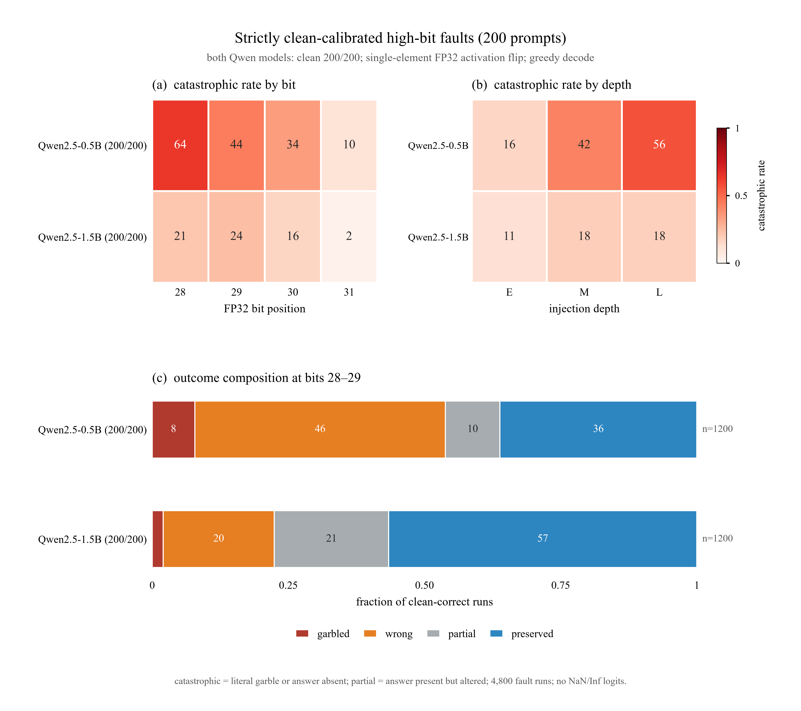

# 严格 clean 校准的 200-prompt 高位注错实验

日期：2026-10-21  
模型：Qwen2.5-0.5B / Qwen2.5-1.5B  
clean 校准：**两个模型均为 200/200 目标答案严格正确**  
注错：单元素 FP32 activation bit flip，bits 28–31，E/M/L 三层  
状态：4,800 个 fault run + 1,200 个 sham + 400 个 clean，全部完成；无 OOM，无 NaN/Inf

## 摘要

- 200 条 prompt 先做 clean 校准；最终两个 Qwen 模型都达到 **200/200** 严格 clean 正确。
- 1,200 个 sham run 与 clean 完全一致；4,800 个 fault run 都只改变 1 个 bit。
- **Qwen2.5-0.5B：catastrophic 38.0%**（95% CI 36.1–40.0%），literal garble 4.5%，preserved 52.0%。
- **Qwen2.5-1.5B：catastrophic 15.8%**（95% CI 14.4–17.3%），literal garble 1.3%，preserved 69.3%。
- 0.5B 对高位 activation 注错明显更敏感，尤其是 **L 层 bit 28/29**：L28 catastrophic 97.0%，M28 94.0%。
- 1.5B 最敏感的是 **E 层 bit 30**（42.0%）、M 层 bit 29（39.0%）和 L 层 bit 28（32.5%）。
- 所有 fault run 的 logits 都是 finite，没有 NaN/Inf，也没有 runtime error；NaN/Inf 监控会完全漏掉这些语义错误。

矢量版：[`figures/highbit_output_summary_200.pdf`](figures/highbit_output_summary_200.pdf)

图注：**(a)** 2 个 Qwen 模型在 bit 28–31 上的 catastrophic rate，按 E/M/L 三层聚合；**(b)** 在 E/M/L 注入深度上的 catastrophic rate，按 bit 28–31 聚合；**(c)** bit 28–29 合并后的输出结局构成（garbled / wrong / partial / preserved）。两个模型的 clean 都是 200/200；**(c)** 右侧 `n` 为对应有效 run 数。

---

## 1. 输入

### 1.1 模型

| 模型 | Hugging Face ID | 层数 | hidden | Q / KV heads | E/M/L 层 | attention | residual |
|---|---|---:|---:|---|---|---|---|
| Qwen2.5-0.5B | `Qwen/Qwen2.5-0.5B` | 24 | 896 | 14 / 2 | 0 / 12 / 23 | GQA | sequential |
| Qwen2.5-1.5B | `Qwen/Qwen2.5-1.5B` | 28 | 1536 | 12 / 2 | 0 / 14 / 27 | GQA | sequential |

均为 base 模型、FP32。

### 1.2 Prompt 与 clean 校准

最终集为 200 条短答案 prompt，全部使用 few-shot / cloze 形式，目标答案在第一个输出 token 位置可判定。

分类数量：

| 类别 | 条数 |
|---|---:|
| factual | 53 |
| arithmetic | 40 |
| list / sequence | 28 |
| code | 28 |
| continuation | 26 |
| definition / opposite | 25 |
| **合计** | **200** |

**clean 校准过程：**

1. 第一版 200 条 prompt 中，Qwen2.5-0.5B 的严格 clean 正确率是 **191/200**，Qwen2.5-1.5B 是 **196/200**。
2. 这不是 100%，不能进入最终统计。
3. 把两个模型不合格的 13 条 prompt 替换为更容易的 capital 题，重新做 clean-only 校准。
4. 最终两个模型都是 **200/200**：

| 模型 | 第一版 clean | 最终 clean |
|---|---:|---:|
| Qwen2.5-0.5B | 191/200 | **200/200** |
| Qwen2.5-1.5B | 196/200 | **200/200** |

这里的“clean 正确”采用**目标答案严格匹配**：目标答案必须出现在第一个输出 token 位置（多词答案要求完整序列），而不是只在输出后面某处出现。它不要求后续自由续写整段都事实正确；Qwen base 会继续生成无关内容。若要求“整段输出零错误”，需要额外的整段 judge，见局限。

### 1.3 注错输入

| 参数 | 取值 |
|---|---|
| 注入对象 | decoder block 输入的 residual-stream activation |
| 注入层 | E/M/L 三层 |
| 注入 token | 最后一个 prompt token |
| 注入元素 | 该 token 在 block 输入处绝对值最大的单个元素 |
| bit | 28, 29, 30, 31 |
| 精度 | FP32 |
| 注错方式 | int32 视图 XOR 一个 bit |
| 校验 | 每次恰好 1 bit 改变 |
| 生成 | greedy，`max_new_tokens=48`，batch size 1，seed 0 |

### 1.4 运行量

| 条件 | 数量 |
|---|---:|
| fault | 2 模型 × 200 prompt × 3 层 × 4 bit = **4,800** |
| sham | 2 模型 × 200 prompt × 3 层 = **1,200** |
| clean | 2 模型 × 200 prompt = **400** |
| 总 run | **6,400** |

---

## 2. 输出

### 2.1 单次 run 的输出

每个 run 保存：

- prompt 文本；
- clean 输出；
- fault 输出；
- 注入层、token 位置、element index、bit；
- 注入前后 int32、float 值、bit 改变数；
- char similarity、PPL ratio、答案位置；
- literal garble、semantic wrong、partial、preserved、catastrophic 标签；
- runtime error / nonfinite 检查。

示例（Qwen2.5-0.5B，`arit_01`，L 层，bit 28）：

| 字段 | 值 |
|---|---|
| prompt | `1 + 1 = 2. 3 + 3 = 6. 2 + 3 =` |
| clean 输出 | `5. 4 + 4 = 8. ...` |
| fault 输出 | `thói quen, thói quen, ...` |
| char similarity | 0.474 |
| literal garble | 1 |
| semantic wrong | 1 |
| catastrophic | 1 |

另一个例子（Qwen2.5-1.5B，`arit_01`，E 层，bit 30）：

| 字段 | 值 |
|---|---|
| clean 输出 | `5. 3 + 5 = 8. ...` |
| fault 输出 | `! = 11. 3 + 4 = 7. ...` |
| answer present | 0 |
| char similarity | 0.614 |
| catastrophic | 1 |

### 2.2 输出标签

| 标签 | 定义 |
|---|---|
| clean-correct | 目标答案在第一个 token 位置严格匹配 |
| answer present | 答案出现在第一行；短答案类别要求前 6 个 token 内 |
| literal garble | U+FFFD、控制字符、空输出、相对 clean 的退化重复，或异常书写系统 |
| semantic wrong | 答案缺失，或 char similarity < 0.4，或 clean continuation 的 PPL ratio > 5 |
| catastrophic | literal garble 或 semantic wrong |
| partial | 答案仍出现，但位置/格式/上下文改变，或 char similarity < 0.8 |
| preserved | 答案在期望位置且 char similarity ≥ 0.8 |

### 2.3 输出文件

| 文件 | 内容 |
|---|---|
| `runs_all.csv` | 6,400 行最终逐 run 数据 |
| `summary_by_model.csv` | 2 个模型总表 |
| `summary_by_model_bit.csv` | 模型 × bit |
| `summary_by_model_layer.csv` | 模型 × E/M/L |
| `summary_by_model_layer_bit.csv` | 模型 × 层 × bit |
| `summary_by_category.csv` | 模型 × prompt 类别 |
| `summary_by_condition.csv` | 所有 condition 的完整分组 |
| `outcome_by_model_2829.csv` | bit 28–29 的结局构成 |
| `examples.md` | 代表样本 |
| `analysis_meta.json` | 行数、控制校验、输入文件 |

---

## 3. 结果

### 3.1 总体

| 模型 | clean | 有效 fault runs | catastrophic (95% CI) | literal garble | wrong | partial | preserved | mean char sim | median PPL ratio |
|---|---:|---:|---:|---:|---:|---:|---:|---:|---:|
| Qwen2.5-0.5B | 200/200 | 2,400 | **38.0%** (36.1–40.0) | 4.5% | 37.9% | 10.0% | 52.0% | 0.742 | 1.059 |
| Qwen2.5-1.5B | 200/200 | 2,400 | **15.8%** (14.4–17.3) | 1.3% | 15.6% | 14.9% | 69.3% | 0.846 | 1.009 |

合计：1,292/4,800 = **26.9% catastrophic**；141/4,800 = **2.9% literal garble**。

### 3.2 按 bit 聚合

| 模型 | bit 28 | bit 29 | bit 30 | bit 31 |
|---|---:|---:|---:|---:|
| Qwen2.5-0.5B | 63.8% | 43.8% | 34.2% | 10.3% |
| Qwen2.5-1.5B | 21.2% | 23.7% | 16.2% | 2.2% |

### 3.3 按深度聚合

| 模型 | E | M | L |
|---|---:|---:|---:|
| Qwen2.5-0.5B | 15.9% | 42.0% | 56.3% |
| Qwen2.5-1.5B | 11.4% | 18.4% | 17.6% |

- Qwen2.5-0.5B 从 E 到 L 明显恶化（15.9% → 56.3%）。
- Qwen2.5-1.5B 的深度差异小得多（11.4% / 18.4% / 17.6%），整体更稳。

### 3.4 关键 layer × bit 组合

| 组合 | catastrophic |
|---|---:|
| Qwen2.5-0.5B, L, bit 28 | 97.0% |
| Qwen2.5-0.5B, M, bit 28 | 94.0% |
| Qwen2.5-0.5B, M, bit 29 | 68.0% |
| Qwen2.5-0.5B, L, bit 29 | 63.0% |
| Qwen2.5-0.5B, E, bit 30 | 61.0% |
| Qwen2.5-1.5B, E, bit 30 | 42.0% |
| Qwen2.5-1.5B, M, bit 29 | 39.0% |
| Qwen2.5-1.5B, L, bit 28 | 32.5% |
| Qwen2.5-1.5B, L, bit 29 | 31.5% |
| Qwen2.5-1.5B, M, bit 28 | 30.5% |

### 3.5 结局构成（bit 28–29）

| 模型 | garbled | wrong | partial | preserved | n |
|---|---:|---:|---:|---:|---:|
| Qwen2.5-0.5B | 7.8% | 46.0% | 10.0% | 36.2% | 1,200 |
| Qwen2.5-1.5B | 2.0% | 20.4% | 21.0% | 56.6% | 1,200 |

---

## 4. 输出形态

### 4.1 乱码/退化

**Qwen2.5-0.5B，M 层，bit 28**

- clean：`5. 4 + 4 = 8. ...`
- fault：`thói quen, thói quen, thói quen, ...`

越南语词重复，判为 literal garble。

**Qwen2.5-1.5B，cont_07，E 层，bit 31**

- clean：`you! The quick brown fox ...`
- fault：`you! I am a cat. I am a dog. I am a cat. ...`

重复退化，判为 literal garble。

### 4.2 流畅但完全错误

**Qwen2.5-1.5B，arit_01，E 层，bit 30**

- clean：`5. 3 + 5 = 8. ...`
- fault：`! = 11. 3 + 4 = 7. ...`

输出仍像数学续写，但第一个答案从 5 变成 11；判为 semantic wrong。

**Qwen2.5-0.5B，L 层，bit 28**

- clean：`5. 4 + 4 = 8. ...`
- fault：`thói quen. 3 + 3 = 6. 2 + 3 = thói quen. ...`

首答案被语言漂移覆盖；判为 semantic wrong + literal garble。

---

## 5. 控制与有效性

| 检查 | 结果 |
|---|---|
| clean 目标答案 | Qwen0.5B 200/200；Qwen1.5B 200/200 |
| sham vs clean | 1,200/1,200 char similarity 1.000000 |
| fault run bit 改变数 | 4,800/4,800 恰好 1 bit |
| fault value finite | 4,800/4,800 finite |
| 生成 logits nonfinite | 0 |
| runtime error | 0 |

---

## 6. 结论

- 在 **clean 200/200** 的前提下，单元素高位 activation 注错仍会造成大量输出错误：Qwen0.5B 38.0%，Qwen1.5B 15.8%。
- 主要失败仍是**答案完全错误**，不是字面乱码：整体 2.9% literal garble，但 26.9% catastrophic。
- Qwen0.5B 对 **L 层 bit 28/29** 极敏感（L28 = 97.0%）；Qwen1.5B 对 **E 层 bit 30** 和 **M 层 bit 29** 更敏感。
- 所有 fault logits 都是 finite，**NaN/Inf 监控无法检测这些语义错误**。
- 运行时检测必须包含答案一致性/相似度，而不能只看 NaN 或 PPL。

## 7. 局限

- clean 100% 指**目标答案严格正确**；后续自由续写不保证整段无误。若要求整段输出零错误，需要单独的人工/LLM judge。
- 只测试 2 个 Qwen 模型；Pythia 不进入主统计。
- 单元素、最后一个 prompt token、单 seed、bits 28–31；没有多元素、多 token、权重或 KV-cache 注入。
- 200 条 prompt 中 13 条是为达到 200/200 clean 而替换的简单 capital 题；类别分布因此不完全均衡。
- greedy decoding，max 48 tokens；没有采样或 beam search。

## 8. 产物

| 产物 | 路径 |
|---|---|
| 最终 prompt 集 | `data/highbit_prompts_200_calibrated.json` |
| 本报告 | `docs/REPORT_HIGHBIT_OUTPUT_200.md` |
| 逐 run 数据 | `results/llm_highbit_200_calibrated/runs_all.csv` |
| 模型汇总 | `results/llm_highbit_200_calibrated/summary_by_model.csv` |
| bit 汇总 | `results/llm_highbit_200_calibrated/summary_by_model_bit.csv` |
| 层汇总 | `results/llm_highbit_200_calibrated/summary_by_model_layer.csv` |
| 层 × bit | `results/llm_highbit_200_calibrated/summary_by_model_layer_bit.csv` |
| 结局构成 | `results/llm_highbit_200_calibrated/outcome_by_model_2829.csv` |
| 示例 | `results/llm_highbit_200_calibrated/examples.md` |
| 图 | `results/llm_highbit_200_calibrated/figures/highbit_output_summary_200.*` |
| 文档图副本 | `docs/figures/highbit_output_summary_200.*` |
