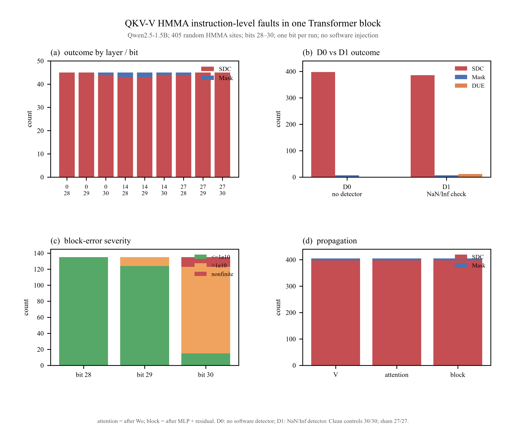

# QKV-V HMMA 指令级注错：单 Transformer Block 的 SDC / DUE / Mask 统计

日期：2026-10-22  
模型：Qwen2.5-1.5B-Instruct  
场景：单个 decoder block 的 qkv_v 逻辑 GEMM；2,264-token prompt  
注入：NVBitFI `mma` 组；HMMA destination register；每 run 1 bit  
范围：**不运行完整 Qwen，不接 LM head，不 decode；统计到 Transformer block 输出**

---

## 1. 实验范围

本实验只运行一个 Qwen2.5 decoder block：

```text
block input
  → input RMSNorm
  → qkv_q / qkv_k / qkv_v
  → RoPE
  → QKᵀ
  → softmax
  → P·V
  → Wo
  → attention residual
  → post-attention RMSNorm
  → MLP gate / up / down
  → MLP residual
  → block output
```

只对 **qkv_v** 的 HMMA 注错。

qkv_v 的逻辑 GEMM：

```text
V = X_norm × W_v
X_norm: [2264, 1536]
W_v:    [1536, 256]
V:      [2264, 256]
```

三个 layer：0 / 14 / 27。block 输入来自 clean Qwen prefill 的对应层输入；不串起其他层，不接 LM head。

---

## 2. 内核与注入位置

每层 qkv_v 对应同一个 kernel：

```text
ampere_bf16_s16816gemm_bf16_128x64_ldg8_relu_f2f_stages_64x4_tn
kernel index = 357
CTAs = 72
HMMA per block = 14,155,776
```

注入方式：

- NVBitFI group `mma`；
- 对 HMMA 执行后的 destination register 翻转 1 个 bit；
- bit：28 / 29 / 30；
- 每 run 只注入 1 次；
- 不注入软件输出，不注入 PyTorch tensor；
- 不注入 decode，因为本实验没有 decode。

### 随机 HMMA 站点

不使用 early/middle/late 分层。每个 layer、每个 bit 从全部动态 HMMA destination-register 站点中均匀随机采样：

```text
3 layers × 3 bits × 45 random sites
= 405 个有效 HMMA fault run
```

- 固定 RNG seed；
- 不放回；
- 先生成 site manifest；
- 记录 `inst_id`、实际 kernel index、before/after、mask、regNo、pcOffset、tid；
- K 位置只作为事后变量，不作为采样分层；
- 405/405 都成功注入，没有 invalid injection。

---

## 3. 检查点与判定

每个 run 记录：

| 检查点 | 内容 |
|---|---|
| **V** | qkv_v 的输出 `[1,2264,256]` |
| **attention** | self-attention 模块输出，即 `Wo(P·V)`，形状 `[1,2264,1536]` |
| **block** | Transformer block 输出，包含 attention residual、MLP、MLP residual |

### D0：默认配置，无软件检测器

```text
CUDA/runtime error → DUE-HW
正常结束，输出与 clean 不同 → SDC
正常结束，输出与 clean bitwise 相同 → Mask
```

在 D0 下：

- 错误答案/乱码/NaN 但程序正常结束 → SDC；
- DUE 只表示运行时失败；
- 本实验 D0 的 DUE = 0。

### D1：敏感性配置，启用 NaN/Inf 检测器

```text
运行时错误 → DUE-HW
NaN/Inf 检测器触发 → DUE-DET
正常但输出错误 → SDC
正常且输出相同 → Mask
```

D1 是单独的敏感性分析，不混入 D0 主表。

---

## 4. 控制组

| 控制 | 结果 |
|---|---:|
| clean，每层 10 次，共 30 次 | **30/30** bitwise 一致 |
| sham，27 次，DUMMY injector 不翻 bit | **27/27** 全部 Mask |
| sham 注入日志 | 27/27 出现 `Injection data` |
| fault 注入 | **405/405** 出现 `Injection data` |
| runtime error | **0/405** |

clean 和 sham 均不进入 405 个 fault 的分母。

---

## 5. 主结果

### 5.1 总体

| 结果 | 数量 | 比例 | 95% CI |
|---|---:|---:|---:|
| **SDC** | **398** | **98.27%** | 96.48–99.16% |
| **Mask** | **7** | **1.73%** | 0.84–3.52% |
| **DUE（D0）** | **0** | **0.00%** | — |
| 合计 | 405 | 100% | — |

D1 敏感性：

| 结果 | 数量 | 比例 |
|---|---:|---:|
| DUE-DET（NaN/Inf 检测） | 12 | 2.96% |
| SDC（D1） | 386 | 95.31% |
| Mask（D1） | 7 | 1.73% |

也就是说：

- **D0：没有运行时 DUE，98.27% 是 silent data corruption；**
- **如果把 NaN/Inf 检测器算作 DUE，则 12 个 bit30 站点会变成 DUE-DET；**
- 12 个 NaN 站点在 D0 下全部计入 SDC。

### 5.2 attention 和 block

三个检查点的结果完全一致：

| 检查点 | SDC | Mask | DUE |
|---|---:|---:|---:|
| V | 398 | 7 | 0 |
| attention（Wo 后） | 398 | 7 | 0 |
| block（MLP + residual 后） | 398 | 7 | 0 |

本样本中没有出现：

- V 已经变化，但 attention 输出不变；
- attention 已经变化，但 block 输出不变。

因此在这组高 bit、单 bit、单 block 实验中，**qkv_v 的 V 输出一旦改变，attention 和 block 输出都继续改变**，没有观察到下游吸收。



矢量版：[`figures/qkv_v_block_hmma_summary.pdf`](figures/qkv_v_block_hmma_summary.pdf)

---

## 6. 按 layer 和 bit

### 6.1 layer

| layer | n | SDC | Mask | DUE |
|---|---:|---:|---:|---:|
| 0 | 135 | 134 | 1 | 0 |
| 14 | 135 | 130 | 5 | 0 |
| 27 | 135 | 134 | 1 | 0 |

### 6.2 bit

| bit | n | SDC | Mask | nonfinite | maxabs > 1e10 | median maxabs | max maxabs |
|---|---:|---:|---:|---:|---:|---:|---:|
| 28 | 135 | 132 | 3 | 0 | 0 | 0.125 | 7.45e9 |
| 29 | 135 | 133 | 2 | 0 | 11 | 0.125 | 3.50e19 |
| **30** | 135 | **133** | 2 | **12** | **108** | **5.65e36** | **1.06e38** |

bit30 是主要风险位：

- 12 个 nonfinite 全部来自 bit30；
- 108 个 block 最大绝对误差超过 `1e10`；
- bit28 没有超过 `1e10` 的样本；
- bit29 只有 11 个超过 `1e10`。

### 6.3 7 个 Mask 的来源

| site | layer | bit | before | after |
|---|---:|---:|---|---|
| L00_b30_021 | 0 | 30 | `0x0` | `0x40000000` |
| L14_b28_026 | 14 | 28 | `0x3aa9d940` | `0x2aa9d940` |
| L14_b28_036 | 14 | 28 | `0x0` | `0x10000000` |
| L14_b29_005 | 14 | 29 | `0x0` | `0x20000000` |
| L14_b29_029 | 14 | 29 | `0x0` | `0x20000000` |
| L14_b30_011 | 14 | 30 | `0x0` | `0x40000000` |
| L27_b28_030 | 27 | 28 | `0x0` | `0x10000000` |

其中：

- 6 个 `before=0`：累加器原本是 0，翻转 bit 只产生极小值，BF16 输出仍为 0；
- 1 个 `0x3aa9d940`：bit28 改变在 BF16 输出舍入后消失。

这不是“attention 或 MLP 吸收了错误”，而是错误在 **V 输出写回阶段**已经被 mask。

---

## 7. 误差严重度

在 398 个 SDC 中：

- 386 个 block 输出为有限值；
- 12 个为 NaN/Inf；
- 386 个有限值中，119 个 `max |Δblock| > 1e10`；
- 最大有限误差约 `1.06e38`。

按 bit：

```text
bit28: 中位 max|Δ| ~ 0.125，最大 ~ 7.4e9，无 >1e10
bit29: 中位 max|Δ| ~ 0.125，最大 ~ 3.5e19，11 个 >1e10
bit30: 中位 max|Δ| ~ 5.6e36，最大 ~ 1.1e38，108 个 >1e10，12 个 NaN/Inf
```

bit30 的故障不只是“答案错”，还可能把 GEMM 输出直接推到极大的指数范围或 NaN。

---

## 8. 解释

1. **在 qkv_v 上，高 bit HMMA 故障几乎总是 SDC。**  
   405 个随机站点中 398 个到达 block 输出并改变它。

2. **bit30 是最危险的位。**  
   12 个 NaN/Inf 全部来自 bit30；bit30 的误差中位数比 bit28/29 高几十个数量级。

3. **本样本中没有 attention→block 的下游吸收。**  
   V 输出一旦改变，attention 和 block 都改变；7 个 Mask 全部是 V 输出层面的 mask。

4. **DUE 取决于检测配置。**  
   D0 没有运行时 DUE；D1 的 NaN/Inf 检测会把 12 个 bit30 站点归为 DUE-DET。不能把错误答案或 `!!!!!!!!` 直接算成 DUE。

5. **qkv_v 的输出级保护很重要。**  
   只依赖最终 block 输出检查会漏掉 attention 内部的状态；但本次样本里 attention 和 block 的可见性一致，说明高 bit 错误会直接穿透。

---

## 9. 局限

- 只测一个 2,264-token case、三个 layer、一个 Transformer block；
- 只测 qkv_v，不外推到 qkv_q/qkv_k/QK/PV/Wo/MLP；
- 只测 bit 28/29/30；低位可能完全不同；
- 每 run 只注入 1 bit，没有多 bit/多元素；
- 不运行完整 Qwen、LM head、decode 或 agent answer；
- D1 是离线分类，不是实际运行中的硬件/软件检测器；
- NVBit 注入的是 HMMA 寄存器边界，不是 Tensor Core 内部 adder tree；
- 随机站点可能包含 dead/零累加器站点，这是有意保留的完整指令级分布；
- 未做多 case 统计，当前只能说明这个 case/layer 的机制。

---

## 10. 产物

| 产物 | 路径 |
|---|---|
| 单 block 输入/clean 检查点 | `results/qkv_v_block/inputs/` |
| 随机站点 manifest | `results/qkv_v_block/sites.csv` |
| 405 个 fault run | `results/qkv_v_block/runs_all.csv` |
| 分 shard 结果 | `results/qkv_v_block/runs_s0..3.csv` |
| 汇总 | `results/qkv_v_block/summary.json` |
| layer×bit 汇总 | `results/qkv_v_block/summary_by_layer_bit.csv` |
| bit 汇总 | `results/qkv_v_block/summary_by_bit.csv` |
| Mask 站点 | `results/qkv_v_block/mask_sites.csv` |
| NaN 站点 | `results/qkv_v_block/nan_sites.csv` |
| clean 控制 | `results/qkv_v_block/clean_controls/` |
| sham 控制 | `results/qkv_v_block/sham.csv` |
| 图 | `results/qkv_v_block/figures/qkv_v_block_hmma_summary.*` |
| 图副本 | `docs/figures/qkv_v_block_hmma_summary.*` |
