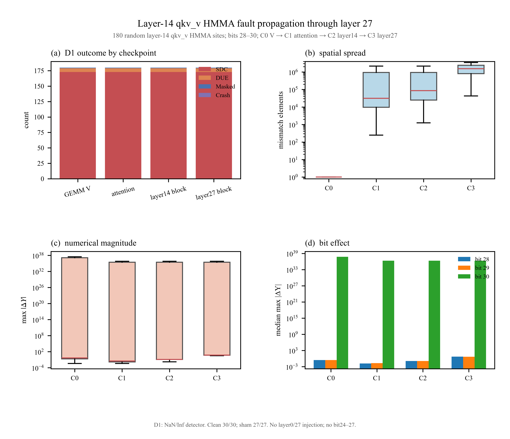

# Layer14 qkv_v HMMA 注错：C0–C3 全链路多检查点报告

日期：2026-10-22  
模型：Qwen2.5-1.5B-Instruct  
注入：layer14 qkv_v，HMMA destination register，1 bit/run  
范围：**不注 layer0/27；不扩 bit24–27；只跑一个 block 注入 + clean downstream**

---

## 1. 实验范围

只在 **layer 14 的 qkv_v** 注入：

```text
V = X_norm × W_v
X_norm: [2264, 1536]
W_v:    [1536, 256]
V:      [2264, 256]
```

注入后继续运行 clean 的 layer15–27，直到 layer27 输出。

四个检查点：

| 检查点 | 内容 |
|---|---|
| **C0** | layer14 qkv_v GEMM 输出 V |
| **C1** | layer14 attention 模块输出，Wo 后 |
| **C2** | layer14 Transformer block 输出 |
| **C3** | layer27 最终 Transformer block 输出 |

C3 不接 final norm、LM head 或 decode。

---

## 2. 注入矩阵

```text
layer14 × 3 bits × 60 random HMMA sites
= 180 个 fault run
```

- bit：28 / 29 / 30；
- 每 run 只翻 1 bit；
- 随机 HMMA destination-register 站点；
- 不做 early/middle/late 分层；
- 不扩 bit24–27；
- 不向 layer0/27 注入；
- 405/405 的旧实验不再混入本报告。

---

## 3. 控制组

| 控制 | 结果 |
|---|---:|
| clean 全链路（layer14→27） | **30/30** bitwise 一致 |
| sham（DUMMY injector，不翻 bit） | **27/27** 全部 Masked |
| sham 注入日志 | 27/27 出现 `Injection data` |
| fault 注入 | **180/180** 成功 |
| invalid injection | 0 |
| crash | **0/180** |

clean 和 sham 不进入 fault 分母。

---

## 4. 分类定义

### D0：无软件检测器

```text
crash / runtime error / 无输出 → Crash
正常结束，C0–C3 与 golden bitwise 不同 → SDC
正常结束，C0–C3 与 golden bitwise 相同 → Masked
```

D0 下 NaN/Inf 但程序正常结束仍计入 SDC。

### D1：NaN/Inf 检测器

```text
Crash → Crash
检测到 NaN/Inf → DUE
正常但输出不同 → SDC
正常且输出相同 → Masked
```

D1 是离线敏感性分类，不混入 D0 主表。

---

## 5. 主结果

### 5.1 D0

四个检查点结果一致：

| 检查点 | SDC | Masked | DUE | Crash |
|---|---:|---:|---:|---:|
| C0 GEMM V | 179 | 1 | 0 | 0 |
| C1 attention | 179 | 1 | 0 | 0 |
| C2 layer14 block | 179 | 1 | 0 | 0 |
| C3 layer27 block | 179 | 1 | 0 | 0 |

```text
SDC   = 179/180 = 99.44%
Masked=   1/180 = 0.56%
DUE   =   0/180
Crash =   0/180
```

### 5.2 D1

| 检查点 | SDC | DUE | Masked | Crash |
|---|---:|---:|---:|---:|
| C0 GEMM V | 173 | 6 | 1 | 0 |
| C1 attention | 173 | 6 | 1 | 0 |
| C2 layer14 block | 173 | 6 | 1 | 0 |
| C3 layer27 block | 173 | 6 | 1 | 0 |

6 个 DUE 全部来自 bit30，且 C0–C3 全部为 NaN/Inf。

### 5.3 按 bit

| bit | D0 SDC | D0 Masked | D1 DUE |
|---|---:|---:|---:|
| 28 | 60 | 0 | 0 |
| 29 | 60 | 0 | 0 |
| 30 | 59 | 1 | 6 |

bit28/29 没有 Masked；唯一的 Masked 是 bit30 的零累加器站点。

---

## 6. 多维度 golden vs actual

下表基于 D0 的 179 个 SDC。  
`mismatch` 是 C0–C3 各自与 golden 不同的元素数量；误差为有限值。

| 检查点 | mismatch 中位数 | mismatch 最小值 | mismatch 最大值 | maxabs 中位数 | maxabs 最大值 | >1e10 数量 | rel_l2 中位数 |
|---|---:|---:|---:|---:|---:|---:|---:|
| C0 GEMM V | **1** | 1 | 1 | 0.444 | 3.06e38 | 52 | 6.03e-4 |
| C1 attention | **31,344** | 248 | 3,477,504 | 0.03125 | 3.11e37 | 52 | 3.99e-4 |
| C2 layer14 block | **86,663** | 1,252 | 3,477,504 | 0.125 | 3.11e37 | 52 | 9.96e-5 |
| C3 layer27 block | **1,555,001** | 42,824 | 3,477,504 | 5.0 | 3.11e37 | 52 | 9.60e-3 |

### 6.1 关键数值现象

- C0 每次都只有 **1 个 V 元素**改变；
- 但到 C1，中位数已经扩散到 **31,344** 个元素；
- C2 中位数 **86,663**；
- C3 中位数 **1,555,001**，接近 348 万元素的一半；
- C3 的 `rel_l2` 中位数从 C0 的 `6e-4` 上升到 `9.6e-3`；
- C3 的最大绝对误差约 `3.1e37`；
- 52 个 SDC 在 C0–C3 都出现 `maxabs > 1e10`，主要来自 bit30。

C1/C2 的 `maxabs 中位数` 比 C0 小，不代表误差变小；它是因为 C0 的单一元素误差被 BF16 attention/残差重新分配后，最大单元素值不同。传播范围（mismatch）更直接地显示错误在扩大。

---

## 7. 传播矩阵

四个检查点的 D0 结果完全一致：

```text
C0 SDC → C1 SDC → C2 SDC → C3 SDC
C0 Masked → C1 Masked → C2 Masked → C3 Masked
```

本样本中没有出现：

- C0 已改变但 C1 恢复；
- C1 已改变但 C2 恢复；
- C2 已改变但 C3 恢复；
- 上游 Masked 但下游 SDC。

也就是说，在高 bit、单 bit、单 block 注入下，只要 V 输出改变，错误就一路传播到 layer27。

### 7.1 唯一的 Masked

站点：

```text
L14_b30_055
before = 0x0
after  = 0x40000000
```

累加器原本是 0，翻转 bit30 后 BF16 输出仍为 0，因此 C0–C3 全部 Masked。

### 7.2 6 个 DUE

6 个站点全部是 bit30，且在 C0/C1/C2/C3 都出现 NaN/Inf：

```text
L14_b30_000
L14_b30_020
L14_b30_037
L14_b30_045
L14_b30_048
L14_b30_053
```

D0 下它们是 SDC；D1 的 NaN/Inf 检测把它们归为 DUE。

---

## 8. 图示



矢量版：

`figures/qkv_v_fullstack_summary.pdf`

图中：

- (a) D1 下 C0–C3 的 SDC/DUE/Masked/Crash；
- (b) C0–C3 的 mismatch 元素数量；
- (c) C0–C3 的 max |ΔY| 分布；
- (d) bit28/29/30 的 C0–C3 中位 max |ΔY|。

---

## 9. 与之前单 block 结果的区别

之前只看 layer14 block 内部：

```text
V → attention → layer14 block
```

本实验新增：

```text
layer14 block → clean layer15–27 → layer27 block
```

因此可以回答：

- 错误是否会穿过后续 13 层；
- 在 layer27 是否仍然可见；
- C3 的数值误差是否比 C0 更大；
- 单元素 V 错误如何扩散到全序列。

本实验不能回答：

- 最终 answer 是否正确；
- layer0/27 注入的敏感性；
- 低 bit 的影响；
- 其它 GEMM stage。

---

## 10. 局限

- 只注入 layer14；
- 只测一个 2,264-token case；
- 只测 bit28–30；
- 每 run 只翻 1 bit；
- C3 是 layer27 block 输出，不是完整 Qwen 生成结果；
- C1 是 attention 输出（Wo 后），不是原始 attention score；
- downstream layer15–27 是 clean 运行，不含注入；
- D1 是离线 NaN/Inf 检测，不是实际硬件 ECC；
- 不能把结果外推到 layer0/27 注入或其它 stage。

---

## 11. 产物

| 产物 | 路径 |
|---|---|
| 180 个 fault run | `results/qkv_v_full/runs_all.csv` |
| 分 shard | `results/qkv_v_full/runs_s0..3.csv` |
| 随机站点 | `results/qkv_v_full/sites.csv` |
| 总汇总 | `results/qkv_v_full/summary.json` |
| 数值汇总 | `results/qkv_v_full/summary_numeric.csv` |
| 按 bit 汇总 | `results/qkv_v_full/summary_by_bit.csv` |
| clean 控制 | `results/qkv_v_full/clean_controls/` |
| sham 控制 | `results/qkv_v_full/sham.csv` |
| 图 | `results/qkv_v_full/figures/qkv_v_fullstack_summary.*` |
| 图副本 | `docs/figures/qkv_v_fullstack_summary.*` |
