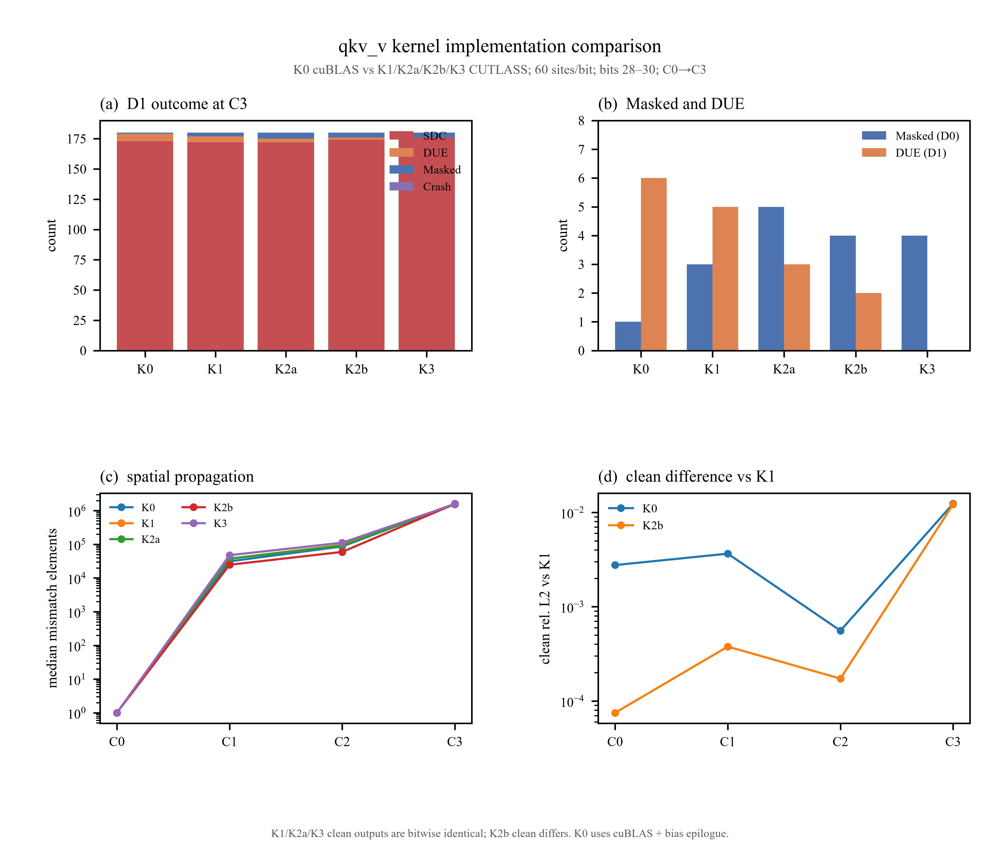

# QKV-V GEMM Kernel 实现对比实验报告

日期：2026-10-22  
模型：Qwen2.5-1.5B-Instruct  
逻辑 GEMM：layer14 qkv_v  
对比对象：**K0 cuBLAS + K1/K2a/K2b/K3 CUTLASS**  
检查点：C0 GEMM V → C1 attention → C2 layer14 block → C3 layer27 block  
总 fault：**900 = 5 variants × 3 bits × 60 random HMMA sites**

---

## 1. 实验目的

固定同一个逻辑 qkv_v GEMM：

```text
V = X_norm × W_v
M=2264, N=256, K=1536
BF16 输入，FP32 accumulate，BF16 输出
```

只改变 kernel implementation，回答：

1. 不同 kernel 的 SDC / DUE / Masked / Crash 分布是否不同；
2. 不同 kernel 的 C0–C3 数值传播是否不同；
3. 若 fault 分布不同，能否归因于实现，而不是 clean 数值差异或随机站点差异。

---

## 2. 五个 kernel

| 版本 | 实现 | 说明 |
|---|---|---|
| **K0** | Qwen 实际 cuBLAS qkv_v | 真实系统基线 |
| **K1** | CUTLASS 基线 | CTA 128×64，K tile 32，Stages 3 |
| **K2a** | 只改流水线 | 同 K1 tile，Stages 5 |
| **K2b** | 改 K tile | CTA 128×64，K tile 64，Stages 3 |
| **K3** | 改 CTA/warp | CTA 128×128，warp 64×64，K tile 32，Stages 3 |

K1/K2a/K2b/K3 都用同一个 CUTLASS source，不同模板实例编译。

### 2.1 一个必须说明的差异

K0 是 cuBLAS + bias epilogue。  
K1–K3 是 CUTLASS GEMM 输出 BF16，再在 Python 下游加 bias。

因此 K0 vs K1 的 clean 差异不仅是 tile/pipeline，还包含：

- cuBLAS vs CUTLASS；
- bias 精度/写回顺序；
- epilogue 差异；
- 累加顺序。

K0 只作为真实基线，不用于“同实现”因果推断。

---

## 3. 实验矩阵

每个 variant：

```text
3 bits (28/29/30) × 60 random HMMA sites
= 180 fault runs
```

5 个 variant：

```text
5 × 180 = 900 fault runs
```

每 run 只翻 1 bit；不做 early/middle/late 分层；不做 software output injection。

检查点：

- C0：qkv_v V；
- C1：layer14 attention 输出（Wo 后）；
- C2：layer14 block 输出；
- C3：layer27 最终 block 输出。

---

## 4. 控制组

| 控制 | 结果 |
|---|---:|
| K0 clean | 30/30 bitwise 一致 |
| K1 clean | 10/10 bitwise 一致 |
| K2a clean | 10/10 bitwise 一致 |
| K2b clean | 10/10 bitwise 一致 |
| K3 clean | 10/10 bitwise 一致 |
| K0 sham | 27/27 Masked |
| K1/K2a/K2b/K3 sham | 每个 9/9，合计 36/36 Masked |
| fault 注入 | 900/900 成功 |
| invalid injection | 0 |
| crash | 0 |

---

## 5. 主结果

### 5.1 D0：无软件检测器

| variant | SDC | Masked | DUE | Crash | SDC 率 |
|---|---:|---:|---:|---:|---:|
| K0 | 179 | 1 | 0 | 0 | 99.44% |
| K1 | 177 | 3 | 0 | 0 | 98.33% |
| K2a | 175 | 5 | 0 | 0 | 97.22% |
| K2b | 176 | 4 | 0 | 0 | 97.78% |
| K3 | 176 | 4 | 0 | 0 | 97.78% |

### 5.2 D1：NaN/Inf 检测

| variant | SDC | DUE | Masked | Crash |
|---|---:|---:|---:|---:|
| K0 | 173 | 6 | 1 | 0 |
| K1 | 172 | 5 | 3 | 0 |
| K2a | 172 | 3 | 5 | 0 |
| K2b | 174 | 2 | 4 | 0 |
| K3 | 176 | 0 | 4 | 0 |

所有 C0–C3 的 outcome 计数与上表一致。  
其中 K0/K1/K2a/K3 每个 run 在 C0–C3 的 outcome 完全一致；K2b 有 1 个例外站点 `K2b_b29_057`：C0/C1 为 SDC，C2/C3 恢复为 Masked（C0 mismatch=1，C1=5，C2/C3=0）。这是本批 900 个 run 中唯一观察到的下游恢复路径。

> K3 的 DUE=0 不能解释为“K3 更安全”，因为 5 个 variant 的随机站点不同；DUE 站点是 bit30 的抽样结果。

---

## 6. 按 bit

| variant | bit28 | bit29 | bit30 |
|---|---|---|---|
| K0 | 60 SDC | 60 SDC | 59 SDC + 1 Masked |
| K1 | 60 SDC | 58 SDC + 2 Masked | 59 SDC + 1 Masked |
| K2a | 58 SDC + 2 Masked | 58 SDC + 2 Masked | 59 SDC + 1 Masked |
| K2b | 58 SDC + 2 Masked | 59 SDC + 1 Masked | 59 SDC + 1 Masked |
| K3 | 59 SDC + 1 Masked | 58 SDC + 2 Masked | 59 SDC + 1 Masked |

整体差异主要是 **随机 HMMA 站点不同**，不能把某个 variant 的 Masked 数直接解释成 kernel 属性。

---

## 7. 多检查点数值对比

D0 SDC 的 median mismatch：

| variant | C0 V | C1 attention | C2 layer14 | C3 layer27 |
|---|---:|---:|---:|---:|
| K0 | 1 | 31,344 | 86,663 | 1,555,001 |
| K1 | 1 | 37,799 | 96,648 | 1,615,872 |
| K2a | 1 | 37,527 | 92,160 | 1,533,044 |
| K2b | 1 | 24,805 | 59,666.5 | 1,587,249 |
| K3 | 1 | 47,754 | 112,041.5 | 1,562,827 |

C0 每个 run 都只有 **1 个 V 元素**改变。  
到 C3，中位数都在 **1.5–1.6M** 个元素，接近 348 万元素的约一半。

median max |ΔY|：

| variant | C0 | C1 | C2 | C3 |
|---|---:|---:|---:|---:|
| K0 | 0.444 | 0.03125 | 0.125 | 5.0 |
| K1 | 0.570 | 0.03125 | 0.125 | 5.0 |
| K2a | 0.582 | 0.03125 | 0.125 | 5.0 |
| K2b | 0.355 | 0.03125 | 0.125 | 5.0 |
| K3 | 0.650 | 0.03223 | 0.125 | 5.0 |

所有 variant 在 C3 的中位最大误差都是 5.0，说明误差传播的宏观量级相近；差异主要体现在少数高 bit 尾部和具体站点。

---

## 8. Clean 差异

### 8.1 K1/K2a/K3

K1、K2a、K3 的 clean C0–C3 **完全 bitwise 相同**：

```text
V、attention、block、final 全部 mismatch=0
```

这就是说：

- 改 Stages（K2a）没有改变 clean 数值；
- 改 CTA/warp（K3）在这组 shape 下也没有改变 clean 数值；
- 因此 K2a/K3 与 K1 的 fault 差异可以较干净地归因于调度/生命周期，而不是 clean 数值顺序。

### 8.2 K2b

K2b 改了 K tile，clean 与 K1 不同：

| 检查点 | mismatch | maxabs | rel L2 |
|---|---:|---:|---:|
| C0 V | 140 | 0.015625 | 7.50e-5 |
| C1 attention | 77,478 | 0.03125 | 3.78e-4 |
| C2 layer14 | 295,453 | 0.125 | 1.73e-4 |
| C3 layer27 | 2,998,023 | 5.0 | 1.22e-2 |

所以 K2b 的 fault 分布差异不能直接归因于 pipeline；它包含 K tile/累加顺序变化。

### 8.3 K0

K0 与 K1 的 clean 差异：

| 检查点 | mismatch | maxabs | rel L2 |
|---|---:|---:|---:|
| C0 V | 150,245 | 0.03125 | 2.76e-3 |
| C1 attention | 1,998,085 | 0.0625 | 3.65e-3 |
| C2 layer14 | 1,713,204 | 0.25 | 5.57e-4 |
| C3 layer27 | 3,012,698 | 5.0 | 1.24e-2 |

这反映 cuBLAS 与 CUTLASS、bias epilogue 和累加顺序的综合差异。

---

## 9. 统一图



矢量版：

`figures/kernel_comparison_summary.pdf`

### 中文解释

- **(a) D1 outcome at C3**：五个 kernel 在 layer27 输出上的 SDC/DUE/Masked/Crash 组成。所有 variant 都以 SDC 为绝对主体；DUE 只在 bit30 的 NaN/Inf 站点出现；Crash 为 0。  
- **(b) Masked and DUE**：蓝色是 D0 下的 Masked 数量，橙色是 D1 下的 DUE 数量。K2a 的 Masked 最多（5），K0 的 DUE 最多（6），K3 本次样本没有 DUE。这个差异包含随机站点抽样，不等于 kernel 的固有安全性排序。  
- **(c) spatial propagation**：从 C0 到 C3 的中位 mismatch 元素数。C0 都只有 1 个元素；到 C1 迅速扩散到 10^4 量级，C3 达到 10^6 量级；五条曲线几乎重合，说明“单个 V 元素错误扩散到全序列”这一宏观规律不随 kernel 明显改变。图中是中位数，不代表每个 run 都单调扩散：K2b 的 `K2b_b29_057` 在 C0/C1 为 SDC，C2/C3 恢复为 Masked。  
- **(d) clean difference vs K1**：K0 和 K2b 的 clean 输出相对 K1 的数值差异；K2a/K3 的 clean 与 K1 完全相同，所以没有画在图中（相对误差为 0）。K0 的差异来自 cuBLAS/bias epilogue；K2b 的差异来自 K tile 改变累加顺序。  

---

## 10. 解释与限制

### 可以说明

1. 5 个 kernel 的 fault 传播都表现为 **C0=1 个元素 → C3=百万级元素**；
2. K1/K2a/K3 的 clean 完全相同，说明 Stages 和 CTA/warp 在这组 shape 下没有改变 clean 数值；
3. K2b 的 clean 不同，证实 K tile 会改变累加顺序；
4. K0 与 CUTLASS 的 clean 不同，不能把 K0 vs K1 的差异全部归因于 pipeline；
5. D0 没有 crash；DUE 只在 D1 的 bit30 NaN/Inf 站点出现。

### 不能说明

- 当前 5 个 variant 使用**独立的随机 HMMA 站点**，不是 paired logical-site，因此不能把 K1/K2a/K3 的 3/5/4 个 Masked 差异直接归因于 kernel；
- K3 的 DUE=0 是抽样结果，不是“K3 不产生 NaN”；
- 不能把 K0 vs K1 的差异全部归因于调度；
- 不能从单 case/layer14 外推到所有层或完整 Qwen；
- 不能把 Tensor Core 内部 adder tree 的 AVF 与当前的寄存器边界实验混为一谈。

### 下一步

如果要从“描述性差异”升级为“因果结论”，需要做 **paired logical-site** 实验：

```text
同一个 output element + 同一个 K segment + 同一个 bit
在 K1/K2a/K2b/K3 上分别注入
```

当前全量实验已经给出了统一分布和 clean 基线，下一步的 paired 实验才用于判断 K2a/K3 的差异是否真实。

---

## 11. 产物

| 产物 | 路径 |
|---|---|
| 统一数据 | `results/qkv_v_kernels/comparison_all.csv` |
| K0–K3 分片数据 | `results/qkv_v_kernels/runs_s0..3.csv` |
| 汇总 | `results/qkv_v_kernels/summary_comparison.json` |
| variant 汇总 | `results/qkv_v_kernels/summary_by_variant.csv` |
| clean 对比 | `results/qkv_v_kernels/clean_compare.json` |
| 随机站点 | `results/qkv_v_kernels/sites.csv` |
| sham | `results/qkv_v_kernels/sham.csv` |
| clean 控制 | `results/qkv_v_kernels/clean_controls/` |
| 图 | `results/qkv_v_kernels/figures/kernel_comparison_summary.*` |
| 图副本 | `docs/figures/kernel_comparison_summary.*` |
| CUTLASS source | `workloads/qkv_v_cutlass.cu` |
| campaign | `scripts/qkv_v_kernel_campaign.py` |
